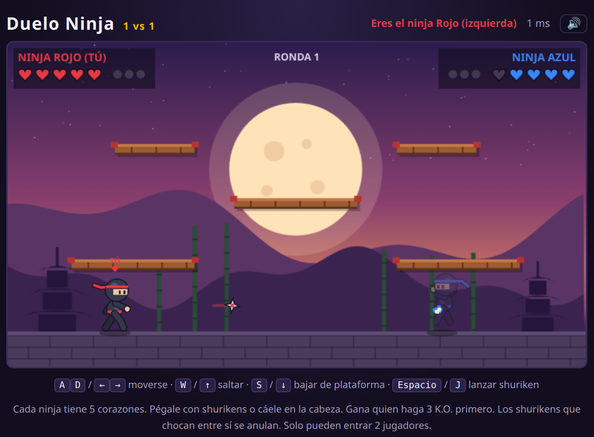
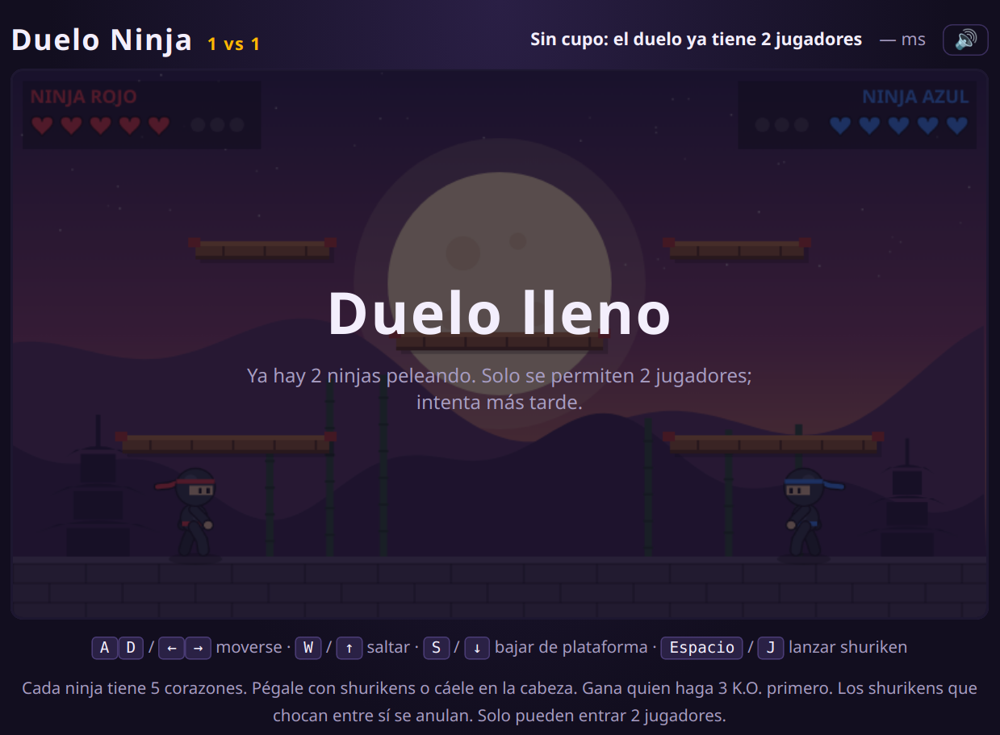

# Mikyosho 🥷 1 vs 1

Juego de pelea en tiempo real para **exactamente 2 jugadores**: dos ninjas se enfrentan en una arena con
plataformas lanzándose shurikens. Hecho con Canvas + JavaScript en el cliente y Node.js + Socket.IO en el servidor.



- **URL pública:** _(pon aquí la URL de Render cuando lo despliegues)_
- **Repositorio:** https://github.com/Emimarti123/2playergame

## Basado en

| Ejemplo | Qué se tomó |
|---|---|
| [`sprite-colisiones`](https://github.com/nzamora-uni/sprite-colisiones) | Sprite sheet con filas por estado (parado, correr, brincar…), ancla en los pies, volteo con `scale(-1, 1)`, física con gravedad y salto corto, aterrizaje encima de obstáculos y colisiones AABB con hitbox más chica que el dibujo, parallax de montañas. |
| [`juegos-dual`](https://github.com/nzamora-uni/juegos-dual) | Servidor autoritativo con Socket.IO, **cupo cerrado a 2 jugadores** desde el middleware, fases (`WAITING → READY → COUNTDOWN → PLAYING → GAME_OVER`), reconexión con gracia, revancha, interpolación en el cliente y pruebas con `node:test`. |

Lo nuevo: personaje propio (ninja cuyo sprite sheet se dibuja con Canvas en [`public/sprites.js`](public/sprites.js),
en dos colores), combate con proyectiles y pisotones, vida por corazones, rondas por K.O., plataformas de un solo sentido,
efectos de partículas y sonido sintetizado.

## Cómo jugar

1. Abre la página en dos navegadores (o dos computadoras). El primero es el **ninja Rojo**, el segundo el **ninja Azul**.
2. Ambos pulsan **¡Listo!** → cuenta regresiva 3-2-1.
3. Cada jugador tiene **5 corazones**. Quita uno con cada espadazo, shuriken o pisotón que acierte.
4. Quien deja al rival en 0 gana la ronda (K.O.). **Gana el primero en hacer 3 K.O.**
5. Los shurikens que chocan entre sí se anulan; tras recibir un golpe hay un momento de invulnerabilidad (parpadeo).

| Acción | Teclas |
|---|---|
| Moverse | <kbd>A</kbd> <kbd>D</kbd> (o <kbd>←</kbd> <kbd>→</kbd>) |
| Saltar (soltar pronto = salto corto) | <kbd>W</kbd> |
| Bajar de una plataforma | <kbd>S</kbd> |
| Espadazo | <kbd>Q</kbd> |
| Lanzar shuriken (mantener = ráfaga) | <kbd>E</kbd> |
| Parry | <kbd>Shift</kbd> izquierdo |
| Silenciar | <kbd>M</kbd> |

### Espada y parry

- **Espadazo:** se ve venir (0.15 s levantando la espada), corta al frente a corta distancia, quita 1 corazón y empuja lejos.
- **Parry:** mirando al rival, justo cuando llega el golpe (ventana de 0.2 s).
  - Contra un **espadazo**: no recibes daño y el atacante queda **aturdido** 0.6 s, tiempo para contraatacar.
  - Contra un **shuriken**: rebota hacia quien lo lanzó, 30 % más rápido.
  - **Si no paras nada**, quedas 0.4 s vulnerable: no se puede tener el parry pulsado todo el tiempo.
- **Espada contra espada:** si los dos cortan a la vez, las espadas chocan y ambos retroceden.
- El **pisotón** sigue funcionando: caerle en la cabeza al rival le quita 1 corazón.

## Menú: personaje y escenario

En la pantalla de "¡Listo!" (y en la de revancha) cada jugador escoge:

- **Su personaje.** Cada quien el suyo. Ves cuál eligió tu rival, y un aro de color (rojo/azul) bajo los pies distingue a los dos si eligen el mismo.
- **Su escenario**, o **Al azar**. Al empezar la partida, el servidor **sortea entre las dos elecciones**
  (un "al azar" se convierte antes en un escenario cualquiera). El resultado se anuncia en la cuenta
  regresiva, por ejemplo: *"Sorteo: Noche azul vs Bosque → Bosque"*. Cada revancha vuelve a sortear.

### Agregar fondos y personajes

Los fondos y personajes nuevos se hacen con ChatGPT a partir de una imagen. Los prompts y los pasos
están en **[docs/PROMPTS.md](docs/PROMPTS.md)**. En resumen:

1. Abre **http://localhost:3000/plantillas.html** y descarga las plantillas de referencia.
2. Sube a ChatGPT la plantilla y tu imagen, con el prompt correspondiente.
3. Prueba el resultado en la misma página (sección "Probar"): ahí ves si se recortó bien.
4. Copia la imagen a `public/fondos/` o `public/personajes/` y agrega la línea que te da el probador a
   [`public/catalog.json`](public/catalog.json). Reinicia el servidor.

Formato del personaje: cuadrícula de 4×6 en 1024×1536 (parado ×4, correr ×4, salto ×3 + golpe, lanzar ×2 + K.O.,
espadazo ×3 + parry, aturdido ×2), mirando a la derecha, con fondo transparente o verde liso. El juego quita el fondo, recorta cada pose y la alinea por los pies
([`public/characters.js`](public/characters.js)). En los fondos, el suelo y las plataformas siempre los dibuja el
juego, para que coincidan con la física.

## Límite de 2 jugadores

El cupo se controla en el servidor, en el middleware `io.use()` de [`server/index.js`](server/index.js), **antes** de
aceptar la conexión. Si ya hay dos ninjas (o uno está desconectado pero dentro de su tiempo de reconexión), el tercero
recibe `duel_full`, ve la pantalla **"Duelo lleno"** y nunca entra a la sala ni recibe el estado del juego.



- Si un jugador se desconecta, su lugar se reserva 10 s y la partida se pausa; si no vuelve, el rival gana por abandono.
- Si alguien no pulsa "Listo" en 60 s, se le saca para liberar el lugar.

## Ejecutar en local

Requiere Node.js 20 o superior.

```bash
npm install
npm start          # http://localhost:3000
npm test           # pruebas: física, duelo, catálogo e integración con sockets
```

Variables de entorno: `PORT` (3000), `WIN_SCORE` (3), `RECONNECT_GRACE_MS` (10000),
`ALLOW_SAME_BROWSER=1` (solo desarrollo: permite dos jugadores desde pestañas del mismo navegador sin compartir lugar).

> Dos pestañas del mismo navegador ya cuentan como jugadores distintos (el id se guarda en `sessionStorage`, que es por pestaña).

## Publicar (URL pública) en Render

1. Sube el repositorio a GitHub.
2. En [render.com](https://render.com) → **New → Blueprint** → elige el repositorio. Render lee [`render.yaml`](render.yaml)
   (o bien **New → Web Service** con build `npm ci --omit=dev` y start `npm start`).
3. Al terminar, Render da una URL tipo `https://mikyosho.onrender.com`. Compártela con tu rival.

En el plan gratuito el servidor se duerme tras un rato sin uso; la primera visita tarda unos segundos en despertar.

## Estructura

```
server/
  config.js   Constantes (arena, plataformas, física, vida, tiempos)
  game.js     Lógica pura: movimiento, plataformas, shurikens, pisotón, daño, KO
  duel.js     Slots (máx. 2), fases, rondas, menú y sorteo de escenario, reconexión, revancha. Sin sockets
  catalog.js  Lee y valida public/catalog.json
  index.js    Express + Socket.IO; cupo en io.use(); bucle a 60 Hz, estado a 30 Hz
public/
  index.html, style.css
  catalog.json   Lista de escenarios y personajes del menú
  sprites.js     Dibuja con Canvas el sprite sheet del ninja incluido
  characters.js  Carga personajes: ninja incluido o sprite sheet en imagen (quita fondo, recorta, alinea)
  stages.js      Escenarios: temas dibujados o imagen + suelo y plataformas
  client.js      Input, menú, interpolación, render, HUD, partículas, sonido
  plantillas.html / plantillas.js   Plantillas para ChatGPT y probador de imágenes
  fondos/, personajes/              Imágenes agregadas al catálogo
test/               node:test (física, duelo, integración con socket.io-client)
```
